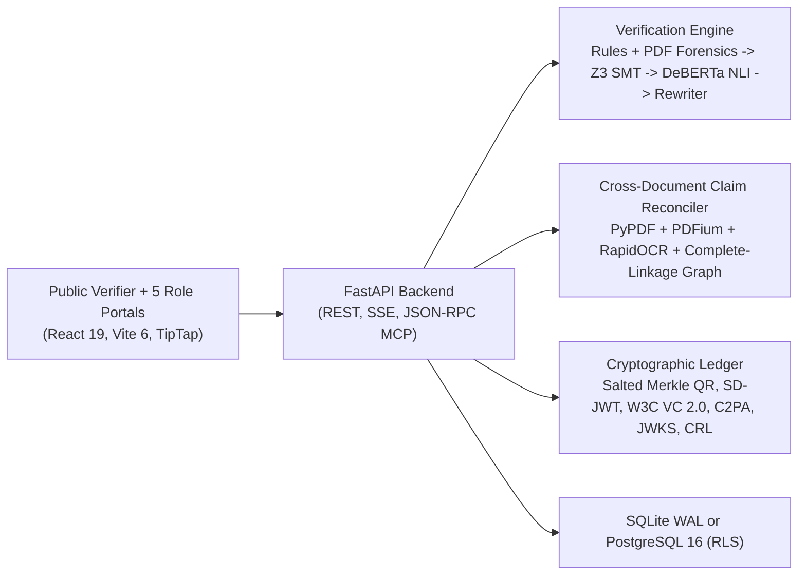

# Pramaan (प्रमाण)

Pramaan is a web platform for Indian colleges and K-12 schools to check statutory disclosures against campus records, catch conflicting claims across PDFs, and issue student passes that anyone can verify offline. Licensed under Apache-2.0 ([LICENSE](LICENSE), [NOTICE](NOTICE)).

## What it does

Colleges and schools maintain audited numbers in internal registers for NAAC, NIRF, AICTE, AISHE, CBSE Appendix IX, and UDISE+, while brochures, placement circulars, and student resumes circulate separately. Pramaan ties those surfaces together across six role-scoped views:

| Surface | Who uses it | What happens there |
| --- | --- | --- |
| Public verifier | Anyone (no login) | Paste a QR code string, upload a QR PNG, or verify an RFC 9901 SD-JWT offline against the institution's public keys and revocation list. |
| Registrar and IQAC ledger | Campus admins, principals | Record NAAC metrics, Criterion IV spend, placement registers, CBSE Appendix IX K-12 certificates, and custom attendance rules (such as waiving attendance above a 9.0 CGPA). Import student and faculty CSVs with dry-run validation, provision role-bound logins, reconcile PDFs, edit and sign circulars in Review Studio, compile plain-English rules into YAML canons, test CMS webhook gates and the read-only MCP gateway, and rotate Ed25519 signing keys. |
| Faculty ledger | Teachers | Check medical attendance condonation petitions with Z3 SMT proofs against campus ceilings and CGPA waivers, and view synced biometric attendance and grant records. |
| Student pass | College and K-12 students | Choose which verified fields to reveal, mint signed QR passes, stamp the QR onto page 1 of a resume PDF, run a private pre-flight resume check against the transcript, and revoke previously issued passes. Students under 18 cannot issue passes until a linked parent grants recipient-scoped consent under DPDP Rule 10. |
| Parent portal | Parents and guardians | Compare published brochure figures side by side with audited ERP records, see expired K-12 school safety certificates, and grant or revoke time-bound consent for specific recipients (with DigiLocker OAuth 2.0 PKCE support). |
| Recruiter desk | Hiring teams | Verify Base45 QR passes, camera scans, PNG uploads, and SD-JWTs offline. Screen batches of resumes against drive cutoffs (CGPA, backlogs, batch year), auto-decode stamped Page-1 QRs, and quarantine PDFs hiding low-contrast or micro-font prompt injections. |

## How the verification pipeline works



When a document or draft is checked, Pramaan runs four stages in sequence:

1. Deterministic rules and PDF forensics (~2 ms) check declarative YAML canons in [pramaan/canons](pramaan/canons) for prohibited wording and required disclaimers, and inspect raw PDF graphics streams to catch white-on-white text (`1 1 1 rg`), sub-4pt microtext, and hidden layers.
2. Persistent Z3 SMT proofs (1 to 12 ms) verify arithmetic constraints that text models miss: credit-weighted CGPA, medical condonation caps and CGPA waivers, Criterion IV budget cross-footing, placement denominators, reducing-balance APR/IRR, and coupled CBSE K-12 classroom and pupil-teacher ratios.
3. Semantic NLI with split conformal calibration (35 to 110 ms) pairs adaptive Reciprocal Rank Fusion retrieval with batched `cross-encoder/nli-deberta-v3-base` scoring. Thresholds are calibrated on an empirical `n = 160` stratified fold (80 HEI and 80 K-12 claim pairs in [conformal_fold_v2.json](pramaan/backend/src/pramaan/engine/conformal_fold_v2.json)) over signed margins `(p_c - p_e)` to bound false negatives at the selected confidence level.
4. Draft rewriting masks seven Indian campus PII patterns (PRN, roll number, Aadhaar, PAN, IFSC, phone, email) before calling an optional external LLM, or applies deterministic local AST edits when running air-gapped, then re-runs the compliance checks before presenting the revision.

For multi-document audits, Claim Reconciler uses complete-linkage clustering to avoid transitive false merges, normalizes Indian currency and unit scales (such as matching `Rs. 3.17 Crores` with `INR 317 Lakhs`), and opens rendered PDF pages via PDFium with word-level bounding boxes.

Student passes are signed with rotating Ed25519 keys exposed at `/.well-known/jwks.json`. Each pass can be shared as a compact salted RFC 9162 Merkle QR (`PR1:...` in CBOR, zlib, and Base45), an RFC 9901 SD-JWT (`vc+sd-jwt`), or a W3C Verifiable Credential 2.0 JSON-LD file. Published circulars in Review Studio are anchored to a SHA-256 hash chain and signed with an ECDSA P-256 C2PA manifest.

## Quick start

### Option 1: Docker Compose

Run the full app (API plus built frontend) on port `8000` with SQLite WAL storage:

```bash
docker compose up --build
```

To run against PostgreSQL 16 with Row-Level Security enabled using the non-superuser `pramaan_app` role:

```bash
PRAMAAN_DATABASE_URL=postgresql+asyncpg://pramaan_app:pramaan_app_pw@db:5432/pramaan \
  docker compose --profile postgres up --build
```

On first use, `compose.yaml` downloads the DeBERTa and MiniLM weights into the persisted `pramaan_data` volume. If you want an air-gapped image with weights baked in at build time:

```bash
docker compose build --build-arg PRELOAD_MODELS=1
PRAMAAN_OFFLINE_ONLY=true docker compose up
```

### Option 2: Run locally (Node 22 and Python 3.12)

```bash
# 1. Build the self-hosted frontend
cd pramaan/frontend
npm ci
npm run build

# 2. Install and start the FastAPI server (serves API + built SPA on :8000)
cd ../backend
python3 -m venv .venv
.venv/bin/pip install -e ".[dev,postgres]"
.venv/bin/uvicorn pramaan.api.app:app --host 0.0.0.0 --port 8000
```

### First-run setup

Open `http://localhost:8000`. On an empty database, the home page displays the zero-login credential verifier on the left and a one-time setup form on the right to create the campus registrar account. After signing in as the registrar, you can enter NAAC, placement, and K-12 records, upload student and faculty CSV rosters, and create accounts for teachers, students, parents, and recruiters under Manage Registers -> People & Accounts.

### Optional integrations

Copy [.env.example](.env.example) to `.env` if you want to customize runtime behavior. Everything works locally without external keys: leaving `GEMINI_API_KEY`, `OPENAI_API_KEY`, and `OPENROUTER_API_KEY` blank uses the local deterministic rewriter, and leaving `PRAMAAN_DIGILOCKER_CLIENT_ID` blank runs the DigiLocker RFC 7636 S256 PKCE flow in local sandbox mode. Check `GET /api/health` to see server status and model load state.

## Linting and build checks

```bash
# Backend: 10-layer import-linter contracts and Ruff
cd pramaan/backend
.venv/bin/lint-imports
.venv/bin/ruff check src

# Frontend: Oxlint, TypeScript check, and production build
cd ../frontend
npm run lint
npm run build
```

## Project layout

- [pramaan/backend](pramaan/backend): 10-layer Python package (`api` -> `store` -> `mcp` -> `ledger` -> `canon` -> `parsers` -> `checks` -> `engine` -> `erp` -> `domain`), enforced by `import-linter`.
- [pramaan/frontend](pramaan/frontend): React 19, Vite 6, Tailwind CSS v4, and TipTap app with self-hosted Anek Latin, Anek Devanagari, and JetBrains Mono fonts (zero CDN requests).
- [pramaan/canons](pramaan/canons): YAML ordinance definitions (`campus-placement.yaml`, `cbse-k12-disclosure.yaml`, `faculty-academic-audit.yaml`, `naac-aishe-ssrs.yaml`).
- [pramaan/backend/sql/postgres_rls.sql](pramaan/backend/sql/postgres_rls.sql): Multi-tenant PostgreSQL 16 schema, RLS policies, and `pramaan_app` role bootstrap.
